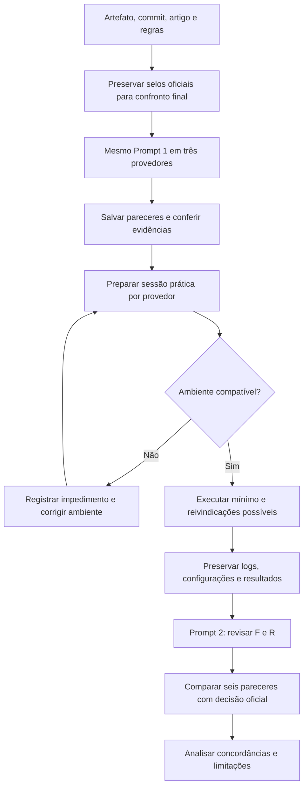

# Processo experimental da Atividade 7

Fluxo planejado; sua presença não comprova execução. Repetir as etapas de avaliação em três provedores distintos.

Se um impedimento não puder ser resolvido, encerrar a sessão como bloqueada, documentar a causa e incluir essa limitação na comparação. Não repetir indefinidamente nem preencher resultados ausentes.
