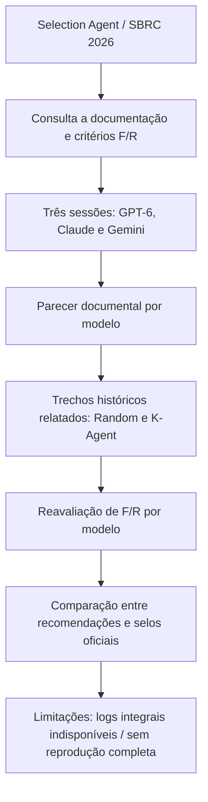

# Fluxo efetivamente documentado — Atividade 7

**Não confundir com um experimento de execução repetido em três ambientes.** O aluno compartilhou textos de duas avaliações em Claude e Gemini; uma avaliação nova com GPT-6 foi criada em 05/11/2026. A nova revisão GPT-6 não reproduz necessariamente o prompt literal aplicado nos modelos anteriores.

**Limitações metodológicas essenciais:** os **dois prompts históricos foram iguais** nas três LLMs. Porém, não há comprovação de que o mesmo snapshot de documentação foi disponibilizado ou consultado por todas. As três avaliações são registros documentais; a segunda etapa analisou fragmentos de execução relatados, sem execuções independentes. A fase prática se limitou ao exame de trechos de execução informados pelo aluno, sem execução independente por modelo. Sem acesso à máquina Ubuntu, não há como autenticar logs originais nem refazer a comparação das métricas do artigo.

**Protocolo prospectivo mais rigoroso:** para repetir um estudo controlado, usar o mesmo [prompt padronizado proposto](PROMPTS_UTILIZADOS.md), mesmos materiais/versionamento, e sessões práticas distintas com stdout/stderr e ambiente preservados.
