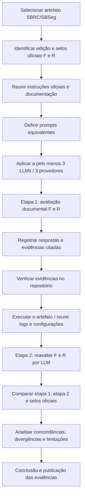

# Fluxograma — protocolo de avaliação da Atividade 7

> Fluxograma do **procedimento exigido**. As etapas representadas não constituem, por si só, comprovação de sua execução.

### Evidência já apresentada
- Método `random`: log de simulação concluída.
- Método `k-agent`: tentativa interrompida por `ConnectionRefusedError` na conexão com Ollama.

**Importante:** uma falha de conexão não permite concluir que o K-Agent tenha defeito lógico; tampouco constitui reprodução bem-sucedida do experimento principal.
