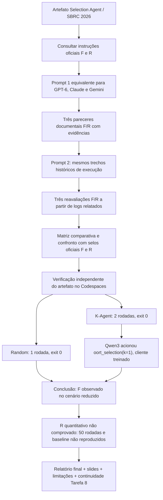

# Fluxograma auditado — Atividade 7 (versão 06/11/2026)

Este documento distingue os **pareceres históricos das três LLMs** das **execuções posteriores no Codespaces**. Não afirmar que cada LLM executou o Flower.

## Controle metodológico

1. **Fonte normativa:** as [instruções oficiais do SBRC 2026](https://doc-artefatos.github.io/sbrc2026/revinstrucoes.html) foram preservadas em [INSTRUCOES_SBRC2026.txt](evidencias/INSTRUCOES_SBRC2026.txt). Os prompts originais **referenciaram o endereço**, mas as transcrições não comprovam que todos os modelos receberam integralmente ou acessaram a mesma versão das instruções.
2. **Padronização:** os dois prompts históricos de GPT-6 e Claude são textualmente idênticos; o Gemini contém os mesmos enunciados em impressão PDF. Isso **não demonstra igualdade de acesso às fontes ou de snapshot de código**.
3. **Execução nas três sessões:** a segunda etapa foi **reavaliação sobre logs históricos resumidos**; não houve três execuções independentes realizadas por LLMs.
4. **Execução real posterior:** em 06/11/2026, [auditoria das duas rodadas](evidencias/AUDITORIA_KAGENT_2_RODADAS_2026-11-06.md) comprovou seleção por Qwen3/Ollama na rodada 2, com respostas HTTP 200, ferramenta Oort e saída 0. O pacote original possui SHA-256 `d5667dd68c7c596f25d12e7810a3f43c336ab97dce0274857c62a4eeceee5e41`.
5. **Selo R:** nenhuma medição quantitativa independente confirmou a alegada redução de tráfego de 44,4% a 59%; a ausência dessas evidências limita **nossa confirmação de R**, sem revogar os selos oficiais do evento.
6. **50 rodadas:** o enunciado acadêmico não as impõe expressamente; elas aparecem no experimento principal dos autores e são relevantes para testar a reivindicação científica.
7. **Origem temporal:** as três LLMs não foram reavaliadas usando os novos logs das duas rodadas. Seus pareceres históricos foram mantidos intactos.

## Fontes
- [Resultados oficiais do SBRC 2026](https://doc-artefatos.github.io/sbrc2026/results.html)
- [Repositório original K-Agent](https://github.com/rafaeloj/sbrc2026)
- [GPT-6 original](evidencias/GPT6_TRANSCRICAO_ORIGINAL_2026-11-06.md) | [Claude original](evidencias/CLAUDE_TRANSCRICAO_2026-11-05.md) | [Gemini original](evidencias/GEMINI_AVALIACAO_ORIGINAL_2026-11-05.md)
- [Comparação CSV](comparacao_llms.csv)
