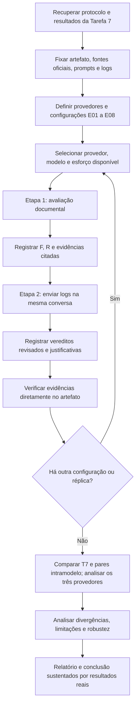

# Fluxograma — Tarefa 8

O fluxo preserva artefato, critérios, prompts e logs da Tarefa 7. O protocolo agora contempla OpenAI, Anthropic e Google. Versão e esforço variam dentro de cada provedor; níveis de esforço de provedores distintos não são necessariamente equivalentes.

